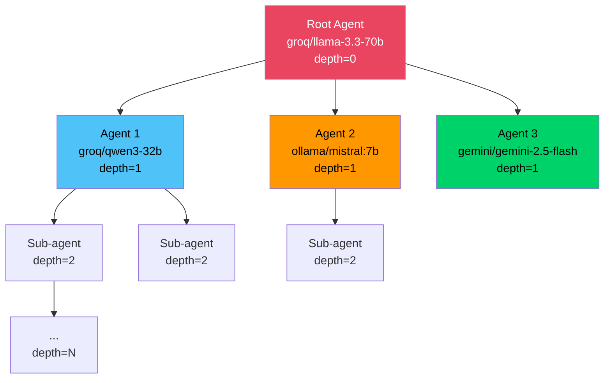
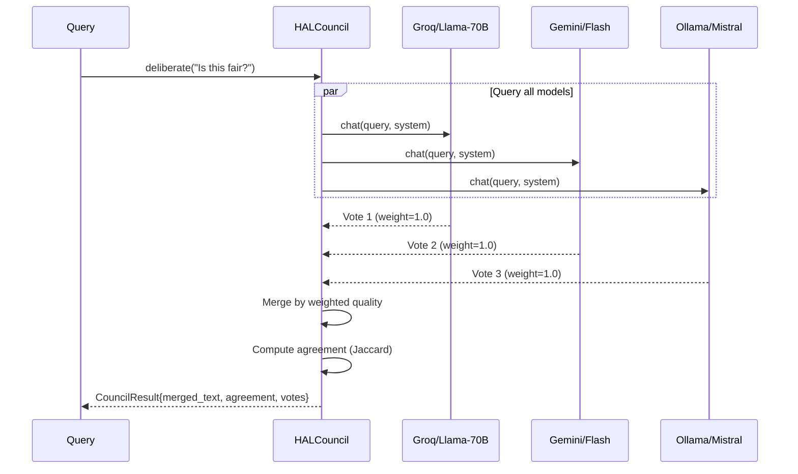
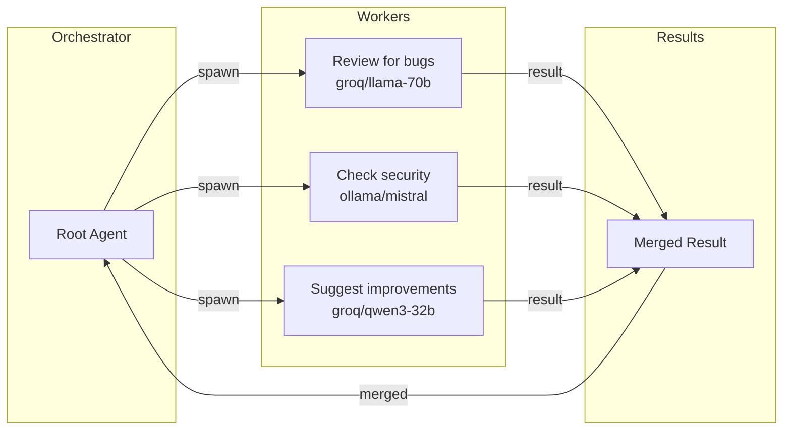

# HAL Agent Spawning and Council Mesh

## Recursive Agent Spawning



**Key properties:**
- Any agent can spawn sub-agents to configurable depth (default max_depth=21)
- Each agent can use a **different LLM provider** (cross-LLM mesh)
- Results propagate up: sub-agents report to their parent
- Cost tracked at every level

## Council (Mixture of Experts)



## Agreement Scoring

The council uses Jaccard word-overlap similarity against a reference vote:

```
agreement = average(
    |words_ref AND words_vote| / |words_ref OR words_vote|
    for each non-reference vote
)
```

- **High agreement (>60%)**: Models converge on answer — high confidence
- **Medium agreement (30-60%)**: Partial convergence — review individual votes
- **Low agreement (<30%)**: Models diverge — indicates complex/ambiguous query

## Spawn Mesh Pattern


