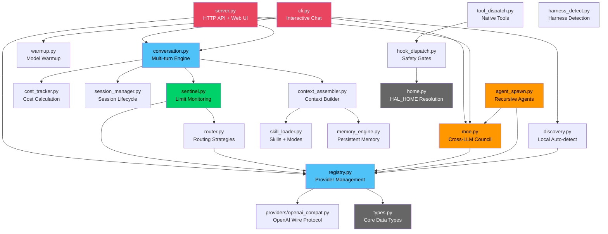

# HAL Architecture Overview

## Module Dependency Graph



## Layer Architecture

```mermaid
graph LR
    subgraph Surface["Surface Layer"]
        C[CLI]
        W[Web UI]
        M[MCP]
    end
    
    subgraph Engine["Engine Layer"]
        CONV2[Conversation]
        CTX2[Context Assembly]
        HOOKS2[Hook Dispatch]
    end
    
    subgraph Intelligence["Intelligence Layer"]
        COUNCIL[Council / MoE]
        AGENTS[Agent Spawner]
        RSI[RSI Engine]
    end
    
    subgraph Provider["Provider Layer"]
        REG2[Registry]
        SENT2[Sentinel]
        ROUTE2[Router]
    end
    
    subgraph LLM["LLM Providers"]
        GROQ[Groq]
        GEM[Gemini]
        OLL[Ollama]
        OAI2[OpenAI]
        ANT[Anthropic]
    end
    
    Surface --> Engine
    Engine --> Intelligence
    Intelligence --> Provider
    Provider --> LLM
```



## Data Flow

```
User Input
    |
    v
[CLI / Server / MCP]  <-- Surface
    |
    v
[Conversation Engine]  <-- Manages history, cost, mode
    |
    v
[Context Assembler]    <-- HAL.md chain + skills + memory + git
    |
    v
[Limit Sentinel]       <-- Checks provider health + utilisation
    |
    v
[Router]               <-- Selects strategy (fixed/fallback/quality-cost)
    |
    v
[Provider Registry]    <-- Resolves provider/model address
    |
    v
[OpenAI-compat HTTP]   <-- Universal wire protocol
    |
    v
[LLM Response]
    |
    v
[Cost Tracker]         <-- Records tokens + USD
    |
    v
[Hook Dispatch]        <-- PostToolUse / PostSampling hooks
    |
    v
User Output
```

## Gateway / Egress Rail

The module graph above covers the **conversation engine** (the `hal` CLI and
HTTP server talking to providers). HAL also ships a second, equally important
surface: the **Gateway / Egress rail** — a local Anthropic/OpenAI-compatible
reverse proxy on `/v1/*` that lets *any* coding harness (Claude Code, Aider,
Cline, OpenAI Codex CLI, Goose) reach Anthropic — or any HAL-registered
provider — through HAL, transparently.

```
Coding harness (Claude Code / Codex / Aider / Cline)
    |
    v
[gateway.py]              <-- /v1/messages reverse proxy (Anthropic-compat, P1)
[gateway_openai.py]       <-- /v1/chat/completions (OpenAI-wire harnesses, P2)
[gateway_responses.py]    <-- /v1/responses (Codex wire_api="responses", P6)
    |
    v
[gateway_guard.py]        <-- default-deny: the public hal-server tunnel is
    |                          never an unauthenticated open relay
    v
[gateway_crosswire.py /   <-- translate Anthropic<->OpenAI wire when the client
 gateway_translate.py /        and the target provider speak different wires
 gateway_stream_crosswire.py]  (streaming and non-streaming)
    |
    v
[gateway_egress.py]       <-- same-wire re-pointing: forward the original body
    |                          verbatim to a non-Anthropic provider
    v
[gateway_failover.py]     <-- ordered upstreams; on 429/5xx, try the next one
    |
    v
[gateway_witness.py]      <-- WITNESS + SIGN every inference on the chat rail
    |                          (the provability-moat / "VeriSign-of-AI" floor)
    v
Provider (Anthropic / Groq / Gemini / OpenAI / local)
```

Two shipped features here are the largest the conversation graph omits:

- **`gateway_witness.py`** — witnesses and cryptographically signs every
  inference that crosses the chat rail, closing the gateway's last
  unwitnessed surface (`/v1/chat/completions`). This is the audit / provability
  foundation that the IDR chain builds on.
- **`grip_runtime` (`grip_infer`)** — GRIP's first-class default LLM runtime.
  It drives a single happi `infer` envelope through the real happi runtime over
  the **RAILLM ladder** (CCH subscription -> Kimi/Qwen subscription -> cheap
  API tiers -> local), with stateful failover that carries conversation history
  across provider switches. happi.md is the syscall surface; RAILLM is the
  failover substrate. See `docs/ADR-0001-hal-raillm-grip-runtime.md` for the
  decision record.
