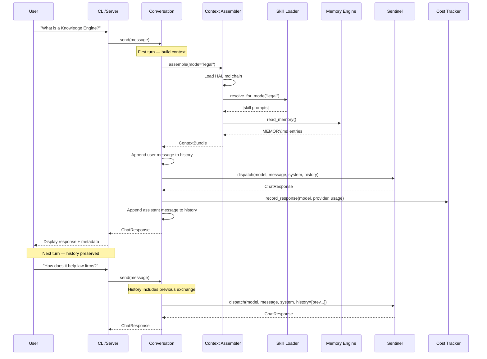
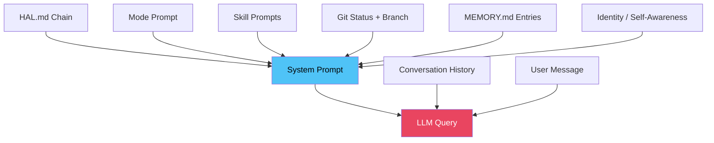

# HAL Conversation Flow

## Multi-Turn Conversation



## Context Assembly



## HAL.md Resolution Chain

```
Priority order (first found wins per level):

1. <project>/.hal/HAL.md        ← Project-specific HAL instructions
2. <project>/.claude/CLAUDE.md  ← Project-specific CC instructions  
3. <project>/CLAUDE.md          ← Legacy location
4. ~/.hal/HAL.md                ← Global HAL instructions
5. ~/.hal/CLAUDE.md             ← Global fallback

All found files are concatenated into the system prompt.
HAL.md takes priority over CLAUDE.md at the same directory level.
```
