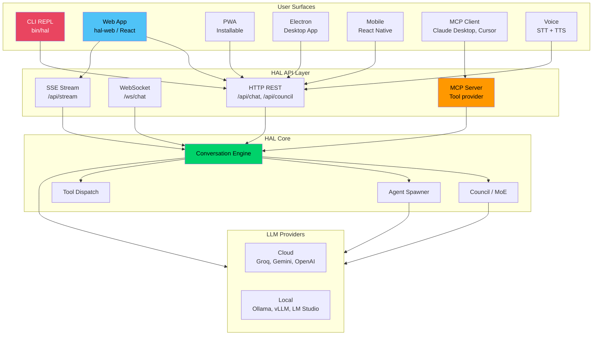

# HAL Multi-Surface Architecture

## Surface Layer



## Current Status

| Surface | Technology | Status |
|---------|-----------|--------|
| CLI (REPL) | Python (`bin/hal`) | Done |
| Web (embedded) | Inline HTML in `server.py` | Done |
| Web (React app) | React + Vite + Tailwind | Planned (hal-web) |
| PWA | Web + manifest + SW | Planned |
| Electron | Electron shell around hal-web | Planned |
| Mobile | React Native (from grip-mobile) | Planned |
| MCP Server | Python MCP protocol | Planned |
| Voice | STT + TTS integration | Planned |

## API Endpoints

```
GET  /                    # Web UI (embedded HTML or hal-web)
GET  /api/status          # System status (providers, skills, modes, agents)
GET  /api/providers       # Provider list with health
POST /api/query           # Single-turn query (provider + prompt)
POST /api/chat            # Multi-turn conversation (message + optional model)
POST /api/council         # Cross-LLM council query
GET  /api/stream          # SSE token streaming (planned)
WS   /ws/chat             # WebSocket chat (planned)
```

## Daemon Mode (Planned)

```
hal --daemon start        # Background HTTP server + mesh + warmup
hal --daemon stop         # Graceful shutdown
hal --daemon status       # Show PID, uptime, connections

Always on. No sessions. Cross-device handoff.
Mesh heartbeat broadcasts to ~/.hal/state/mesh/{pid}.json
```
