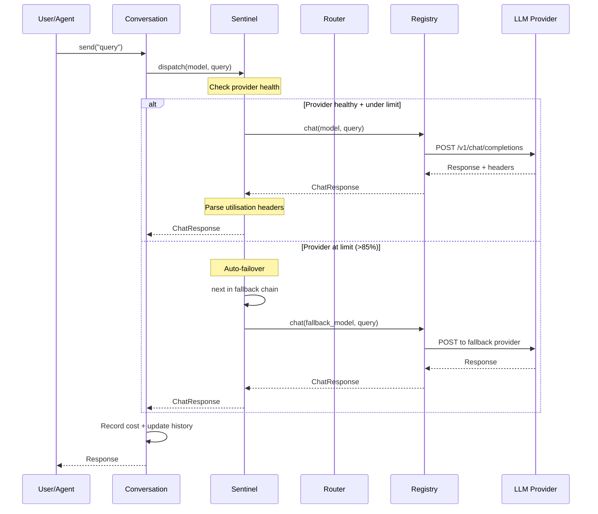
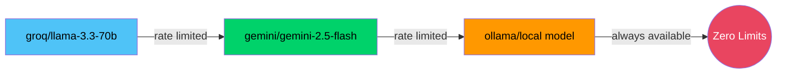
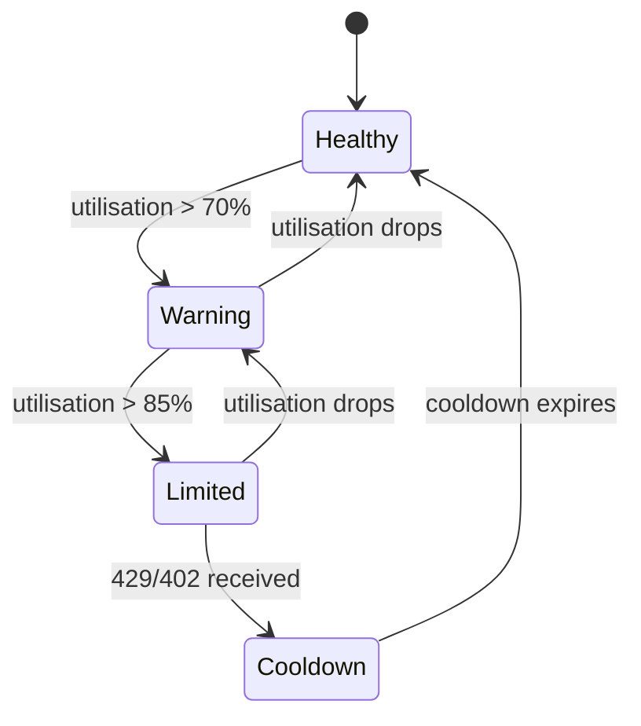

# HAL Provider Routing

## Routing Flow

## Fallback Chain

## Routing Strategies

| Strategy | Selection Logic | Use Case |
|----------|----------------|----------|
| **Fixed** | User specifies `provider/model` directly | Explicit model selection |
| **Fallback** | Try chain in order, skip on failure/rate-limit | Default: resilient routing |
| **Quality-Cost** | Triage by query complexity (simple→cheap, complex→premium) | Cost optimisation |
| **Council** | Query all available models, merge by weighted vote | Critical decisions |

## Provider Health States

